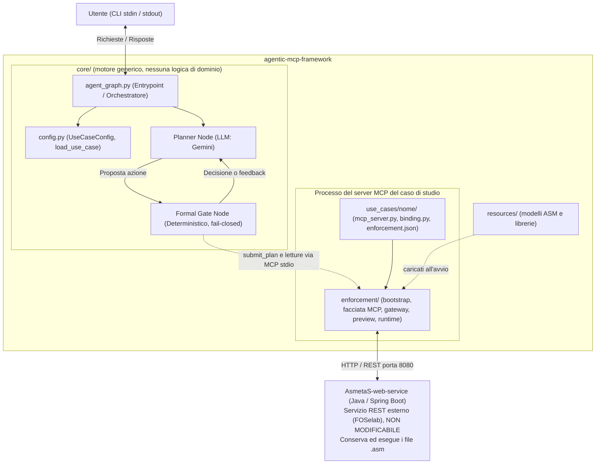
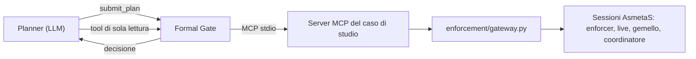

# ARCHITECTURE.md — System Architecture & Component Boundaries

Questo documento descrive l'architettura complessiva del framework, i confini architetturali e i protocolli di comunicazione tra l'Agente, il server MCP del caso di studio e il servizio esterno.

---

## 1. Visione d'Insieme e Confini dei Sistemi

Il sistema separa nettamente il motore generico (`core/`), il framework di enforcement (`enforcement/`), i casi di studio (`use_cases/`), i modelli ASM (`resources/`) e il servizio esterno di verifica formale.

Il Formal Gate invia ogni azione al server MCP del caso di studio, che contiene il framework di enforcement: il server la verifica con i modelli ASM, la esegue sul sistema live e restituisce la decisione. Il Formal Gate esegue direttamente solo i tool dichiarati di sola lettura.

---

## 2. Definizione dei Ruoli dei Componenti

### 2.1 `core/` — Motore di Orchestrazione Generico
* **Ruolo:** Framework general-purpose per Agenti Intelligenti con orchestrazione a grafo (LangGraph) e verifica formale deterministica a runtime tramite Abstract State Machines (ASM).
* **Cosa include:**
  - `agent_graph.py`: entrypoint, costruzione del grafo, sessione MCP con il caso di studio e ciclo CLI. La conversazione resta in memoria per tutta la chat; a ogni turno si azzerano contatori e verdetto.
  - `config.py`: la dataclass `UseCaseConfig` e `load_use_case()`.
  - Nodi del grafo: `planner_node.py`, `formal_gate_node.py`; stato condiviso in `agent_state.py`.
  - `mcp_utils.py`: decodifica delle risposte dei tool MCP.
  - `cli_formatter.py`: visualizzazione in terminale e lettura dell'input; un testo incollato resta un unico messaggio fino a Invio.
* **Cosa NON include:**
  - **NON contiene i modelli formali ASM (`.asm`):** stanno in `resources/`.
  - **NON contiene logica di dominio:** il Planner scopre i tool via introspection MCP, il Formal Gate distingue i tool di sola lettura tramite l'annotazione MCP `readOnlyHint` e ogni parametro di dominio arriva da `UseCaseConfig`.
  - **NON è il motore di verifica:** le decisioni arrivano dal server MCP del caso di studio.
* **Dipendenza da `enforcement/`:** il core importa solo `enforcement/contracts.py`, per il contratto con il server: nomi dei tool, decisioni finali e URL predefinito di AsmetaS. Il resto dell'enforcement gira nel processo del server.

### 2.2 `use_cases/<nome>/` — Casi di Studio
* **Ruolo:** collegare il motore a un dominio concreto.
* **Contenuto obbligatorio:**
  - `config.py` con `USE_CASE = UseCaseConfig(...)`, che definisce `mcp_server_command` ed eventualmente `max_steps_per_turn` e `planner_hints` (istruzioni di dominio aggiunte al prompt del Planner);
  - `binding.py` con l'implementazione del `ModelBinding` del dominio;
  - la configurazione di enforcement (es. `enforcement.json`), con i modelli da caricare da `resources/` nella sezione `asmeta` e i parametri fidati;
  - `mcp_server.py`, che chiama `enforcement.bootstrap.run_mcp_server` con il binding e la configurazione.
* **Facoltativo:** `run_scenario.py`, che chiama `enforcement.bootstrap.run_scenario_cli`, per esperimenti controllati senza LLM su scenari JSON.
* L'agente mantiene **una sola sessione MCP persistente** con il server del caso di studio per tutta la chat, perché il server tiene in memoria il sistema live e lo stato dell'enforcement.
* **Selezione:** variabile `USE_CASE` nel `.env`, obbligatoria e senza default. Se manca, se il caso non esiste o se la configurazione è incompleta, l'avvio si blocca elencando i casi disponibili.
* **`use_cases/pillbox/`** è il caso di studio di riferimento.

### 2.3 `AsmetaS-web-service` (Web Service Esterno di Terze Parti)
* **Repository di origine:** [foselab/AsmetaS-web-service](https://github.com/foselab/AsmetaS-web-service).
* **Natura:** Applicazione server autonoma in Java (JRE 17+ / Spring Boot) in ascolto su porta HTTP (default: `8080`).
* **Proprietà e Modificabilità:**
  - **Non dipende dallo sviluppatore dell'agente e non può essere modificata.**
  - Va considerata un servizio REST black-box fisso.
* **Responsabilità:**
  - Conserva ed esegue i modelli formali ASM e le librerie (`StandardLibrary.asm`).
  - Il framework di enforcement li carica all'avvio (`POST /upload-model`), leggendoli da `resources/`. Anche le librerie finiscono nella cartella dei modelli del server, perché i modelli le importano dalla propria cartella (`import StandardLibrary`).
  - API REST usate dal client di `enforcement/`: `GET /running-models`, `POST /upload-model`, `GET /model-list`, `POST /start`, `PUT /step`, `GET /get-model-status`, `DELETE /stop-model`.

### 2.4 `enforcement/` — Framework di Enforcement
* **Ruolo:** orchestrare più modelli ASM su `AsmetaS-web-service` senza AsmetaComp. È **esterno a LangGraph**: gira nel processo del server MCP del caso di studio. Le decisioni di safety restano negli ASM; Python avvia le sessioni, esegue i passi, collega output e input e verifica la correlazione tra richiesta, preview, comando e ACK.
* **Moduli:**
  - `contracts.py`: tipi condivisi, protocollo `ModelBinding` e contratto con il Formal Gate (nomi dei tool e decisioni finali);
  - `rest_client.py`: client REST multi-sessione (chiude solo le proprie sessioni, nessun retry automatico delle scritture);
  - `asm_runtime.py`: ciclo di vita delle sessioni e ricostruzione del gemello rigiocando la storia degli input del modello live, con verifica di uguaglianza dello stato;
  - `preview_orchestrator.py`: esegue correzione e azioni residue sul gemello e invoca il coordinatore ASM dopo ogni passo;
  - `gateway.py`: richiesta → enforcer → preview → commit sul live → ACK;
  - `deploy.py`: carica sul web service i modelli elencati nella configurazione del caso di studio;
  - `mcp_facade.py`: tool MCP generici `get_system_state` e `get_plan_status` (sola lettura) e `submit_plan`;
  - `bootstrap.py`: entry point generici del caso di studio, `run_mcp_server` e `run_scenario_cli`.
* **Confine con il dominio:** il protocollo `ModelBinding`, implementato in `use_cases/<nome>/binding.py`, traduce richieste, comandi e osservazioni da/verso gli I/O ASM.

---

## 3. Requisito Fondamentale di Connettività e Fail-Fast

Poiché la sicurezza delle azioni dell'agente si fonda sulla barriera formale (*Formal Gate*), il sistema non può e non deve operare senza il guardiano attivo:

```mermaid
sequenceDiagram
    autonumber
    actor Utente
    participant Agent as core/agent_graph.py
    participant Server as Server MCP del caso di studio
    participant AsmetaS as AsmetaS-web-service (Porta 8080)

    Utente->>Agent: Avvio (python core/agent_graph.py o docker)
    Agent->>Agent: load_use_case(USE_CASE)
    alt USE_CASE non definito, caso assente o non valido
        Agent->>Utente: Initialization or Session Error. Uscita (exit 1)
    end
    Agent->>Server: Spawn subprocess stdio

    rect rgb(30, 41, 59)
        note over Server, AsmetaS: Caricamento modelli e inizializzazione del gateway
        Server->>AsmetaS: POST /upload-model, POST /start, PUT /step
        alt AsmetaS OFFLINE o modello non caricabile
            AsmetaS--xServer: Errore
            Server--xAgent: Il processo termina, pipe chiusa
            Agent->>Utente: Initialization or Session Error. Uscita (exit 1)
            note over Agent, Utente: LA CHAT NON PARTE (FAIL-FAST)
        else Gateway inizializzato
            Agent->>Server: list_tools (submit_plan e get_system_state)
            Agent->>Server: get_system_state
            Server-->>Agent: Stato del sistema
            Agent->>Utente: Formal Gate Agent ready.
            Agent->>Utente: Prompt interattivo "You:" (Avvio Chat)
        end
    end
```

> [!CAUTION]
> Se l'handshake fallisce all'avvio, il framework deve effettuare un **Fail-Fast** interrompendo il processo prima di entrare nel ciclo `while True:` di ricezione dell'input utente.

---

## 4. Flusso Operativo Runtime

Durante la chat, ogni messaggio utente segue la seguente pipeline LangGraph:

```mermaid
sequenceDiagram
    autonumber
    actor Utente
    participant Planner as Planner (Gemini LLM)
    participant Gate as Formal Gate Node
    participant Server as Server MCP del caso di studio (enforcement)

    Utente->>Planner: Intenzione o comando utente
    Planner->>Gate: Tool call proposta
    alt Tool annotato readOnlyHint
        Gate->>Server: BYPASS: lettura
        Server-->>Gate: risultato
        Gate-->>Planner: risultato della lettura
    else Tool attuativo diverso da submit_plan
        Gate-->>Utente: ERROR: azione bloccata, fine turno
    else submit_plan
        Gate->>Server: submit_plan (request_id assegnato dal gate)
        Server->>Server: enforcer ASM, preview, commit sul live, ACK
        alt ALLOW / REPLACE
            Server-->>Gate: azione eseguita (originale o corretta)
            Gate-->>Planner: APPROVED / SHIELDED con esito e azioni rimanenti
        else REPLAN o piano rifiutato prima degli ASM (schema o binding)
            Server-->>Gate: nessuna modifica, motivo
            Gate-->>Planner: feedback per ripianificare
        else BLOCK
            Server-->>Gate: nessuna modifica, motivo
            Gate-->>Planner: BLOCKED, solo risposta finale (nessun tool, final_answer_only)
        else errore operativo
            Gate-->>Utente: ERROR con l'esito del comando (applicato, non applicato, sconosciuto), fine turno, nessuna azione di ripiego
        end
    end
    Planner->>Utente: Risposta finale
```

Dopo `ALLOW` o `REPLACE` il Formal Gate indica al Planner le azioni del piano ancora da eseguire, che vengono inviate una alla volta nello stesso turno. Quando i passi del turno finiscono, il Planner può solo rispondere ed elencare le azioni non eseguite. Se l'LLM restituisce comunque una chiamata a tool o una risposta vuota, la chiamata non viene eseguita e l'utente riceve un avviso fisso.

---

## 5. Linee Guida per Modifiche Future

1. **Modelli ASM solo in `resources/`:** non copiare file `.asm` in altre cartelle del repository.
2. **Non tentare di modificare il Web Service esterno:** va considerato un servizio SaaS fisso. Qualsiasi adattamento avviene nel client REST di `enforcement/`.
3. **Mantenere il Fail-Fast:** qualsiasi refactoring dell'inizializzazione deve preservare la regola per cui, in assenza di `AsmetaS-web-service` raggiungibile o dei modelli richiesti, la sessione interattiva non deve partire.
4. **Mantenere il Fail-Closed:** solo i tool annotati `readOnlyHint` possono saltare il Formal Gate, e l'unico tool attuativo è `submit_plan`. Nessuna azione non verificata deve raggiungere l'ambiente.
5. **Indipendenza dal Dominio:** `core/` ed `enforcement/` non devono assumere dettagli di alcun caso di studio. Per un nuovo dominio basta creare `use_cases/<nome>/` con il `ModelBinding`, la configurazione di enforcement, `mcp_server.py` e `config.py`, aggiungere i modelli in `resources/` e impostare `USE_CASE=<nome>` nel `.env`.
