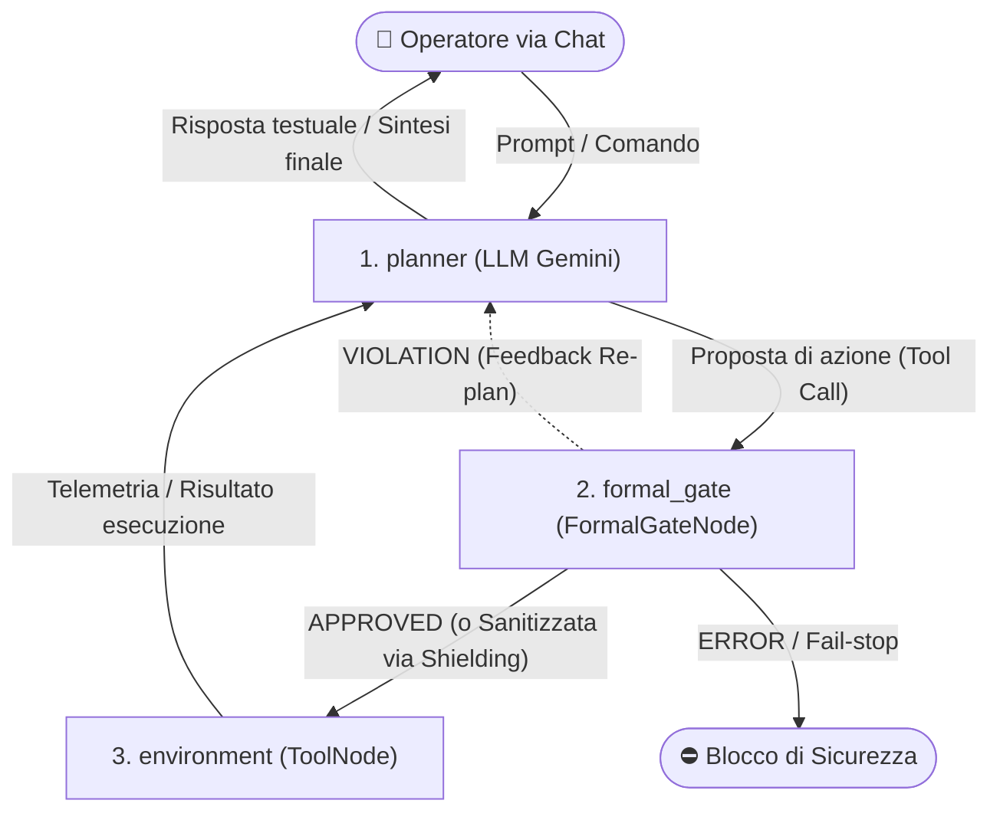
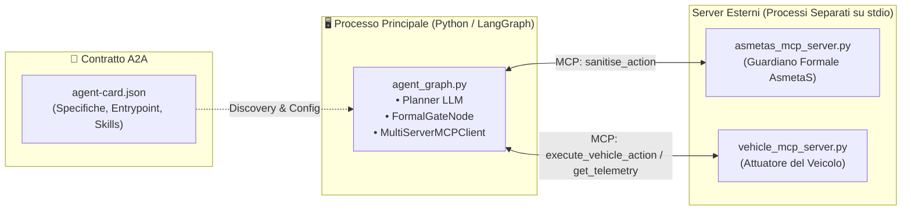
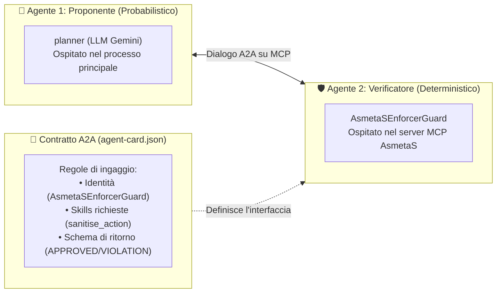

# agentic-mcp-framework

Implementazione di un'architettura che integra l'orchestrazione a grafi (**LangGraph**) con il **Model Context Protocol (MCP)** e la verifica formale deterministica a runtime (**AsmetaS**, basato su Abstract State Machines).

Il sistema applica un'architettura in cui l'operatore interagisce via chat con il modello di linguaggio (Planner), le cui azioni proposte verso l'ambiente vengono intercettate, verificate ed eventualmente sanitizzate o bloccate da un guardiano formale prima dell'effettiva attuazione.

---

## Architettura del Sistema

Per comprendere l'architettura senza ambiguità, il sistema viene analizzato su **due livelli separati**:
1. **Il Flusso Logico (LangGraph)**: come si muove il controllo decisionale tra l'utente, la mente (LLM), la dogana di sicurezza e l'attuatore.
2. **L'Infrastruttura di Processo (MCP & A2A)**: come i componenti software sono disaccoppiati in processi separati tramite standard I/O e contratti formali.

---

### 1. Livello Logico: Il Grafo LangGraph

A livello decisionale, il grafo è un'estensione del classico pattern *ReAct* (`Agente -> Tool`), a cui viene interposto un **filtro deterministico di sicurezza**:



#### Ruolo dei 3 Nodi:
1. **`planner` (Nodo LLM)**:
   - Dialoga con l'utente, mantiene il contesto conversazionale e formula l'intenzione di guida come chiamata a tool (es. `execute_vehicle_action(action="FASTER")`).
   - Riceve l'output dall'ambiente o il feedback della dogana per sintetizzare la risposta.
2. **`formal_gate` (Nodo Deterministico di Sicurezza)**:
   - **Intercetta** l'azione proposta prima che tocchi l'ambiente e la confronta con le regole formali ASM (AsmetaS):
     - **`APPROVED`**: inoltra l'azione inalterata verso l'ambiente.
     - **`VIOLATION` (Shielding)**: corregge l'azione con la variante sicura calcolata da AsmetaS e la invia all'ambiente.
     - **`VIOLATION` (Re-plan)**: rimanda l'errore al `planner` per costringerlo a ripensare l'azione.
     - **`ERROR`**: attiva la policy di sicurezza (es. fail-safe con forzatura di `STOP`).
3. **`environment` (Nodo Esecutivo)**:
   - È il `ToolNode` che esegue concretamente l'azione autorizzata sul veicolo e ne restituisce lo stato aggiornato.

---

### 2. Livello Infrastrutturale: Processi MCP e Contratto A2A

Mentre la logica è sequenziale, a livello di sistema il framework è suddiviso in **tre processi separati** che comunicano tramite standard I/O (JSON-RPC) secondo il protocollo **MCP**:



#### Come si collegano i pezzi:
* **Disaccoppiamento dei Server**: L'ambiente del veicolo (`vehicle_server`) e il runtime formale (`asmetas_server`) girano come processi figli isolati.
* **A2A vs Normale Tool MCP (Con chi si applica il contratto?)**:
  - **Verso il veicolo (`vehicle_server`)**: è una normale relazione **Agente $\rightarrow$ Tool/Ambiente** (classico MCP). Il veicolo è un attuatore passivo privo di autonomia e non ha un'Agent Card.
  - **Verso AsmetaS (`asmetas_server`)**: è una vera relazione **Agent-to-Agent (A2A)**. Il runtime formale viene concettualizzato come un **secondo agente autonomo** (un supervisore deterministico con regole formali proprie), mediato dal contratto `agent-card.json`.
* **Ruolo dell'A2A (`agent-card.json` & `agent_card.py`)**: L'agente principale non ha coordinate hardcoded per il guardiano AsmetaS. All'avvio legge l'**Agent Card** per:
  1. Ricavare l'entrypoint di avvio del processo del guardiano (*Dynamic Discovery*).
  2. Verificare che il server esponga tutte le competenze pattuite (*Skill Handshake*).
  3. Validare a runtime la conformità formale dei verdetti tramite schema Pydantic (*Schema Enforcement*).

#### Ruoli Distinti: Formal Gate (`asmetas_server`) vs Ambiente (`vehicle_server`)

Un punto architetturale cruciale è la netta separazione tra il **motore di regole formali** e il **mondo fisico/ambiente**:

1. **`asmetas_server` (Il Guardiano Formale / Supervisore)**:
   - È un motore logico puro: esegue il simulatore `AsmetaS@run.time`.
   - **Non contiene l'ambiente fisico né agisce su di esso**: non accelera veicoli, non cambia corsie e non gestisce lo stato cinematico. Il suo unico scopo è valutare matematicamente le invarianti ASM (`SafetyEnforcerModel.asm`) ed emettere verdetti di conformità (`APPROVED` o `VIOLATION` con azione sanificata).
   - Espone via MCP l'intero ciclo di vita del modello (scoperta `list_models`, caricamento `upload_model`, avvio sessione `start_enforcer` e step formale `sanitise_action`).

2. **`vehicle_server` (L'Ambiente / Target System / Attuatore)**:
   - Rappresenta il sistema target concreto (il veicolo reale o il suo simulatore).
   - Mantiene lo stato dell'ambiente (velocità in km/h, corsia attuale `center`/`right`, storico attuazioni).
   - Espone i **sensori/probe** (`get_vehicle_telemetry`) e gli **attuatori/effector** (`execute_vehicle_action`).

##### Perché l'Ambiente NON si trova dentro il Server AsmetaS?
Nella teoria formale delle **Abstract State Machines (ASM)**:
- Le funzioni **`monitored`** rappresentano grandezze che la macchina legge dal mondo esterno (i sensori, i probe ambientali o le intenzioni dell'agente, es. `rightLaneFree`, `inputAction`). AsmetaS non può inventare o simulare autonomamente la realtà fisica senza input esterni.
- Le funzioni **`controlled` / `out`** rappresentano le decisioni o le correzioni calcolate dalla logica ASM (es. `outAction`).
- Nel progetto originale `AsmetaS-web-service` (`examples/toy_example/main.py`), l'ambiente era assente e simulato temporaneamente tramite `input()` da terminale. Nel nostro framework, **`vehicle_server` colma esattamente questa lacuna**, incarnando il Target System isolato e comunicante tramite standard MCP.

### Grafo LangGraph vs Servizi Esterni

| Componente | Tipologia | Responsabilità |
| :--- | :--- | :--- |
| **`planner`** | Nodo LangGraph | Ragionamento, proposta azioni e generazione risposta |
| **`formal_gate`** | Nodo LangGraph | Intercezione, enforcement formale e applicazione policy di sicurezza |
| **`environment`** | Nodo LangGraph | Dispatch delle tool call validate verso l'ambiente |
| **`asmetas_server`** | Server MCP (`FastMCP`) | Valutazione delle transizioni di stato tramite simulatore ASM |
| **`vehicle_server`** | Server MCP (`FastMCP`) | Attuatore dell'ambiente (aggiorna velocità, corsia e telemetria) |
| **`agent-card.json`** | Contratto A2A | Descrittore standard per discovery, handshake e validazione schemi |

---

## Struttura del Progetto

```text
agentic-mcp-framework/
├── agent/                         # Core agentico (LangGraph)
│   ├── agent_card.py              # Discovery A2A e validazione contrattuale a runtime (Pydantic)
│   ├── agent_state.py             # Definizione dello stato globale dell'agente (AgentState)
│   ├── planner_node.py            # Nodo 1: Planner LLM e router di conversazione
│   ├── formal_gate_node.py        # Nodo 2: Guardiano deterministico AsmetaS (FormalGateNode)
│   ├── environment_node.py        # Nodo 3: Esecutore dell'ambiente e audit log (EnvironmentNode)
│   └── agent_graph.py             # Grafo LangGraph dell'agente, client MCP e runner CLI
├── mcp_server/                    # Server Model Context Protocol (FastMCP)
│   ├── vehicle_mcp_server.py      # Server attuatore dell'ambiente (VehicleActuatorServer)
│   └── asmetas/
│       ├── asmetas_mcp_server.py  # Server guardiano AsmetaS (asmetas-formal-guard)
│       └── agent-card.json        # Contratto Agent-to-Agent (A2A) per AsmetaS
├── docker-compose.yml             # Configurazione Docker Compose per CLI interattiva
├── Dockerfile                     # Immagine di containerizzazione del framework
├── requirements.txt               # Dipendenze Python
└── README.md                      # Documentazione del repository
```

### Dettaglio dei Moduli

#### Core Agente (`agent/`)
* **`agent/agent_card.py`**: Modulo per il paradigma **Agent-to-Agent (A2A)**: carica ed esamina `agent-card.json`, genera dinamicamente la configurazione per il client MCP dal campo `entrypoint`, valida a runtime che tutti i tool esposti corrispondano alle `skills` contrattuali e impone la validazione dello schema dei verdetti tramite il modello Pydantic `SanitiseContractResult`.
* **`agent/agent_state.py`**: Struttura `AgentState` (TypedDict LangGraph) che tiene traccia della cronologia dei messaggi, azione candidata, variabili monitorate, verdetto formale, azione sanitizzata, tentativi di retry e storico degli audit.
* **`agent/planner_node.py`**: Classe `PlannerNode`, funzione factory `create_planner_node` e `planner_router`: gestisce il prompt di sistema, l'invocazione del modello LLM e l'indirizzamento delle tool call al Formal Gate.
* **`agent/formal_gate_node.py`**: Classe `FormalGateNode`, implementa la logica di intercettazione delle chiamate ai tool, invocazione del server AsmetaS e applicazione delle policy (`shielding`, `replan`, `fail_safe`, `fail_stop`), con validazione runtime contro i vincoli di `agent-card.json`.
* **`agent/environment_node.py`**: Classe `EnvironmentNode` e funzione factory `create_environment_node`: esegue le tool call validate/sanitizzate nell'ambiente del veicolo e aggiorna l'audit trail (`action_history`).
* **`agent/agent_graph.py`**: Costruisce la topologia `StateGraph`, collega i server MCP via `MultiServerMCPClient` (trasporto `stdio`), scopre e valida il server AsmetaS tramite `AgentCard`, definisce i router condizionali ed espone l'interfaccia interattiva CLI con output formattato via `Rich`.

#### Server MCP (`mcp_server/`)
* **`mcp_server/vehicle/vehicle_mcp_server.py` (L'Ambiente di Riferimento / Target System)**:
  Rappresenta il sistema target (l'ambiente fisico o simulatore del veicolo) ed espone:
  * **Attuatori (Effectors)**: `execute_vehicle_action(action)` esegue comandi fisici (`FASTER`, `SLOWER`, `KEEP`, `STOP`, `CHANGE_LANE`, `LANE_RIGHT`, `LANE_LEFT`).
  * **Sensori (Probes)**: `get_vehicle_telemetry()` restituisce telemetria attuale (velocità, corsia, stato corsia destra, ultima azione).
* **`mcp_server/vehicle/agent-card.json`**: Contratto A2A per l'ambiente `VehicleActuatorEnvironment`.
* **`mcp_server/asmetas/asmetas_mcp_server.py` (Il Guardiano Formale / AsmetaS Bridge)**:
  Fa da bridge tra il protocollo MCP e il web service REST di AsmetaS (`AsmetaS@run.time` su porta 8080), esponendo come skill MCP l'intero ciclo di vita formale:
  * `list_models()`: interroga AsmetaS per elencare i modelli `.asm` e le librerie registrate.
  * `upload_model(model_path)`: carica il modello ASM multipart su AsmetaS e garantisce l'upload automatico di `StandardLibrary.asm`.
  * `upload_library(library_path)`: carica librerie ASM ausiliarie.
  * `delete_model(asm_name)`: rimuove modelli dal server AsmetaS.
  * `start_enforcer(asm_name)`: avvia una sessione runtime dell'enforcer sul modello specificato.
  * `sanitise_action(monitored_variables)`: invia le variabili monitorate ed esegue lo step formale, restituendo il verdetto (`APPROVED` o `VIOLATION` con azione sanificata).
  * `stop_enforcer()`: termina la sessione di simulazione formale.
* **`mcp_server/asmetas/agent-card.json`**: Contratto A2A (Agent-to-Agent) che formalizza identità, protocollo, entrypoint e tutte le 7 skill di `AsmetaSEnforcerGuard`.

---

### Architettura Agent-to-Agent (A2A over MCP)

Il framework adotta un modello di cooperazione asimmetrica **Proposer–Verifier (Actor–Supervisor)** implementato sopra il trasporto standard **MCP**. 

Il contratto A2A non si applica indifferentemente a tutti i servizi: distingue nettamente tra l'interazione con un tool passivo (l'attuatore del veicolo) e l'interazione tra due agenti intelligenti/autonomi:



1. **Agente Proponente (`planner`)**: LLM probabilistico che interpreta i comandi utente e formula intenzioni di guida candidata.
2. **Agente Guardiano Deterministico (`AsmetaSEnforcerGuard`)**: Entità simbolica deterministica che incapsula la specifica ASM, mantiene lo stato della sessione e verifica gli invarianti di sicurezza.
3. **Contratto A2A Attivo a Runtime (`agent-card.json` & `agent_card.py`)**:
   * **Dynamic Discovery**: All'avvio, il framework carica l'Agent Card e ricava automaticamente i parametri di avvio del server MCP (`entrypoint`, `transport`, `env`), senza configurazioni hardcoded nel codice del planner.
   * **Skill Verification**: Il framework convalida che i tool registrati nel server MCP soddisfino tutte le skill dichiarate nella card.
   * **Schema Enforcement**: Ogni verdetto restituito da `sanitise_action` viene validato a runtime tramite Pydantic (`SanitiseContractResult`). In caso di risposta malformata o verdetto non consentito, viene sollevata una violazione contrattuale A2A e gestita dalla policy di fail-safe.

#### Perché l'Agent Card esiste solo per AsmetaS e non per Planner, Formal Gate o Environment?

Un'**Agent Card** funge da contratto di federazione e carta d'identità tra entità eterogenee che operano in ambienti o processi disaccoppiati. I componenti del sistema si differenziano nettamente per natura e collocazione:

1. **`planner`, `formal_gate` ed `environment` sono nodi interni (*in-process*)**:
   - Non sono agenti esterni o microservizi: sono classi e funzioni Python (`PlannerNode`, `FormalGateNode`, `EnvironmentNode`) in esecuzione nello **stesso identico processo Python** orchestrato da LangGraph.
   - Condividono la memoria RAM e si scambiano lo stato tramite l'oggetto Python `AgentState`. Non necessitano di discovery dinamico, di entrypoint CLI o di trasporto stdio: il loro contratto è il codice sorgente Python stesso.

2. **`vehicle_server` è un Tool passivo, non un Agente**:
   - Sebbene sia un processo esterno separato (server MCP), è un **attuatore privo di autonomia decisionale** (si limita a eseguire `execute_vehicle_action` o `get_vehicle_telemetry`).
   - Nel protocollo MCP, i tool passivi utilizzano il discovery standard dei comandi (`tools/list` con JSON Schema). Attribuirgli un'Agent Card sarebbe concettualmente improprio, non trattandosi di un agente.

3. **`asmetas_server` è un Agente Guardiano autonomo (*out-of-process*)**:
   - Viene trattato come supervisore formale indipendente a "scatola nera".
   - L'Agent Card (`agent-card.json`) permette di disaccoppiarlo completamente dal codice del planner, dichiarando dinamicamente come lanciarlo (`entrypoint`), quali abilità offre (`skills`) e garantendo contrattualmente la struttura dei verdetti formali (`APPROVED` o `VIOLATION`).

| Componente | Natura Architetturale | Collocazione Processo | Ha una Agent Card? | Motivazione |
| :--- | :--- | :--- | :---: | :--- |
| **`planner`** | Nodo Logico (LLM) | Processo Master (In-Process) | ❌ No | Nodo interno del grafo LangGraph |
| **`formal_gate`** | Nodo Logico (Middleware) | Processo Master (In-Process) | ❌ No | Nodo interno del grafo LangGraph |
| **`environment`** | Nodo Logico (Dispatcher) | Processo Master (In-Process) | ❌ No | Nodo interno del grafo LangGraph |
| **`vehicle_server`** | Server MCP Tool Provider | Processo Esterno (Out-of-Process) | ❌ No | Attuatore/Tool passivo (non un agente) |
| **`asmetas_server`** | **Agente Guardiano (A2A)** | Processo Esterno (Out-of-Process) | **✅ Sì** | **Agente supervisore autonomo disaccoppiato** |

---

## Avvio Rapido (Docker)

Il progetto è completamente containerizzato per garantire isolamento e riproducibilità.

### 1. Configurazione delle variabili d'ambiente

Copia il template `.env.example` in `.env` e imposta la tua API Key di Google AI Studio:

```bash
cp .env.example .env
```

Contenuto di `.env`:
```plaintext
GEMINI_API_KEY=la_tua_google_ai_studio_api_key
# Opzionale: URL del web service AsmetaS (default: http://localhost:8080)
# ASMETAS_URL=http://localhost:8080
```

### 2. Avvio dell'Agente

#### Opzione A: Esecuzione in Locale (Sviluppo e Test Diretto)

1. **Avvia il Web Service AsmetaS** (in un terminale separato):
   ```bash
   cd ../AsmetaS-web-service/asmeta\ server
   python asmeta_runtime_server.py
   ```
   *Il server Java Spring Boot / Tomcat si avvierà su `http://localhost:8080`.*

2. **Avvia l'agente interattivo**:
   ```bash
   cd agentic-mcp-framework
   source .venv/bin/activate
   python agent/agent_graph.py
   ```
   *All'avvio, l'agente interrogherà AsmetaS via MCP (`list_models`), caricherà automaticamente il modello `SafetyEnforcerModel.asm` (e `StandardLibrary.asm`) tramite `upload_model`, e avvierà la sessione di guardia formale.*

#### Opzione B: Container Docker Compose

Esegui la build e avvia l'agente in modalità CLI interattiva tramite Docker Compose:

```bash
docker-compose run --rm agentic-system
```

*(L'uso del comando `run` anziché `up` collega stdin e stdout del terminale al container, permettendo di chattare direttamente con l'agente in tempo reale).*

### 3. Esempi di Interazione

Durante la sessione interattiva, puoi sperimentare il comportamento del Formal Gate testando diversi scenari di sicurezza:

1. **Azione conforme (Approved)**:
   ```text
   You: Mantieni la velocità, la corsia di destra è occupata (rightLaneFree=false).
   ```
   *Esito:* L'azione `KEEP` rispetta i vincoli ASM e viene eseguita inalterata sull'attuatore.

2. **Violazione delle regole di sicurezza (Sanitised / Shielded)**:
   ```text
   You: Accelera a tutta velocità (FASTER), la corsia di destra è libera (rightLaneFree=true).
   ```
   *Esito:* Il modello formale rileva una violazione del codice/regola (obbligo di occupare la corsia più libera a destra) e sanitizza l'azione trasformandola in un cambio corsia sicuro prima dell'esecuzione.

3. **Interrogazione dell'ambiente**:
   ```text
   You: Qual è la telemetria attuale del veicolo?
   ```
   *Esito:* Il Planner invoca `get_vehicle_telemetry` per riportare velocità e stato della corsia.

---

## Documentazione Estesa & Wiki

Per approfondimenti sul setup del simulatore `AsmetaS-web-service`, sulle specifiche dei modelli ASM e sui test end-to-end, consulta la [Wiki di Progetto](https://github.com/gallizzz/agentic-mcp-framework/wiki).
