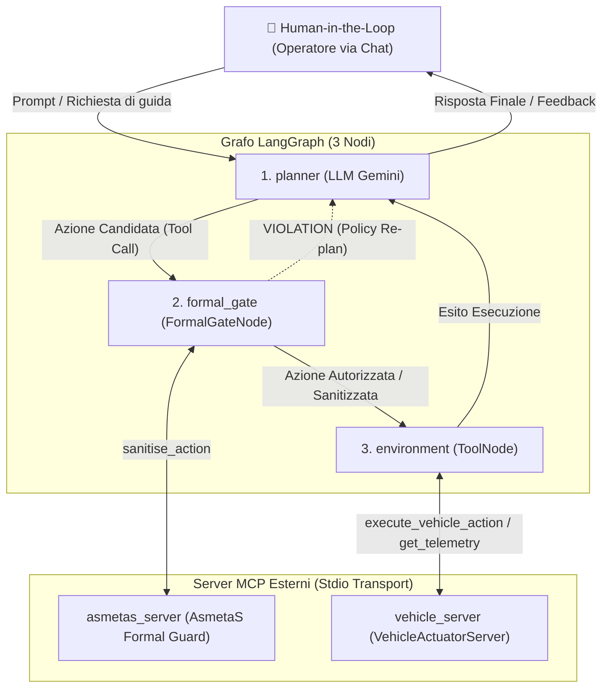

# agentic-mcp-framework

Implementazione di un'architettura che integra l'orchestrazione a grafi (**LangGraph**) con il **Model Context Protocol (MCP)** e la verifica formale deterministica a runtime (**AsmetaS**, basato su Abstract State Machines).

Il sistema applica un'architettura in cui l'operatore interagisce via chat con il modello di linguaggio (Planner), le cui azioni proposte verso l'ambiente vengono intercettate, verificate ed eventualmente sanitizzate o bloccate da un guardiano formale prima dell'effettiva attuazione.

---

## Architettura del Sistema

Il flusso decisionale ed esecutivo è orchestrato come uno **`StateGraph` LangGraph composto da 3 nodi principali**, guidato dall'interazione dell'utente e collegato a **2 server MCP esterni** disaccoppiati:



### I 3 Nodi del Grafo LangGraph

1. **`planner` (Nodo LLM)**:
   - Riceve le richieste e i comandi dell'operatore umano (**Human-in-the-Loop**) via chat e mantiene il contesto della conversazione.
   - Ragiona sulla strategia e propone un'azione candidata formulandola come chiamata a tool (es. `execute_vehicle_action(action="FASTER")`).
   - Dopo l'esecuzione nell'ambiente, riceve i risultati per sintetizzare la risposta finale all'utente.

2. **`formal_gate` (Nodo Deterministico di Sicurezza - `FormalGateNode`)**:
   - **Intercetta determinisicamente** la tool call del Planner prima che questa possa raggiungere l'ambiente.
   - Invoca il tool `sanitise_action` sul server MCP AsmetaS per verificare la conformità con il modello formale ASM:
     - Se **`APPROVED`**: inoltra l'azione inalterata al nodo `environment`.
     - Se **`VIOLATION` (Policy Shielding)**: riscrive l'azione candidata sostituendola con la variante sicura calcolata formalmente da AsmetaS, procedendo verso `environment`.
     - Se **`VIOLATION` (Policy Re-plan)**: re-inietta il feedback di violazione nel contesto del `planner` per forzare una ripianificazione guidata da vincoli (entro un limite di retry).
     - Se **`ERROR` / Timeout**: applica la policy di sicurezza configurata (es. fail-safe con comando forzato `STOP`).

3. **`environment` (Nodo Esecutivo - `ToolNode`)**:
   - È il `ToolNode` standard di LangGraph configurato con i tool dell'attuatore.
   - Esegue fisicamente l'azione (validata o sanitizzata) chiamando il server MCP `vehicle_server`.
   - Restituisce l'output di telemetria e attuazione al nodo `planner`.

### Grafo LangGraph vs Server MCP Esterni

| Componente | Tipologia | Responsabilità |
| :--- | :--- | :--- |
| **`planner`** | Nodo LangGraph | Ragionamento, proposta azioni e generazione risposta |
| **`formal_gate`** | Nodo LangGraph | Intercezione, enforcement formale e applicazione policy di sicurezza |
| **`environment`** | Nodo LangGraph | Dispatch delle tool call validate verso l'ambiente |
| **`asmetas_server`** | Server MCP (`FastMCP`) | Valutazione delle transizioni di stato tramite simulatore ASM |
| **`vehicle_server`** | Server MCP (`FastMCP`) | Attuatore dell'ambiente (aggiorna velocità, corsia e telemetria) |

---

## Struttura del Progetto

```text
agentic-mcp-framework/
├── agent/                         # Core agentico (LangGraph)
│   ├── formal_gate_state.py       # Definizione dello stato dell'agente (FormalAgentState)
│   ├── formal_gate_node.py        # Nodo formale deterministico (FormalGateNode)
│   └── formal_gate_graph.py       # Grafo LangGraph, client MCP e runner CLI
├── mcp_server/                    # Server Model Context Protocol (FastMCP)
│   ├── vehicle_mcp_server.py      # Server attuatore dell'ambiente (VehicleActuatorServer)
│   └── asmetas/
│       ├── asmetas_mcp_server.py  # Server guardiano AsmetaS (asmetas-formal-guard)
│       └── agent-card.json        # Contratto Agent-to-Agent (A2A) per AsmetaS
├── docker-compose.yml             # Configurazione Docker Compose per CLI interattiva
├── Dockerfile                     # Immagine di containerizzazione del framework
├── requirements.txt               # Dipendenze Python
└── README.md                      # Documentazione del repository
```

### Dettaglio dei Moduli

#### Core Agente (`agent/`)
* **`agent/formal_gate_state.py`**: Struttura `FormalAgentState` (TypedDict LangGraph) che tiene traccia della cronologia dei messaggi, azione candidata, variabili monitorate, verdetto formale, azione sanitizzata, tentativi di retry e storico degli audit.
* **`agent/formal_gate_node.py`**: Classe `FormalGateNode`, implementa la logica di intercettazione delle chiamate ai tool, invocazione del server AsmetaS e applicazione delle policy (`shielding`, `replan`, `fail_safe`, `fail_stop`).
* **`agent/formal_gate_graph.py`**: Costruisce la topologia `StateGraph`, collega i server MCP via `MultiServerMCPClient` (trasporto `stdio`), definisce i router condizionali ed espone l'interfaccia interattiva CLI con output formattato via `Rich`.

#### Server MCP (`mcp_server/`)
* **`mcp_server/vehicle_mcp_server.py`**: Espone i tool dell'ambiente di guida simulato:
  * `execute_vehicle_action(action)`: esegue comandi quali `FASTER`, `SLOWER`, `KEEP`, `STOP`, `CHANGE_LANE`.
  * `get_vehicle_telemetry()`: restituisce telemetria attuale (velocità, corsia, ultima azione).
* **`mcp_server/asmetas/asmetas_mcp_server.py`**: Bridge verso il simulatore runtime AsmetaS (`AsmetaS@run.time`):
  * `start_enforcer(asm_name)`: avvia l'enforcer sul modello ASM specificato.
  * `sanitise_action(monitored_variables)`: verifica e sanitizza l'azione candidata in accordo alle regole ASM.
  * `stop_enforcer()`: termina la sessione di simulazione formale.
* **`mcp_server/asmetas/agent-card.json`**: Specifica A2A che descrive metadati, protocolli e interfacce dell'enforcer AsmetaS.

---

## Avvio Rapido (Docker)

Il progetto è completamente containerizzato per garantire isolamento e riproducibilità.

### 1. Configurazione delle variabili d'ambiente

Copia il template `.env.example` in `.env` e imposta la tua API Key di Google AI Studio:

```bash
cp .env.example .env
```

Contenuto di `.env`:
```plaintext
GEMINI_API_KEY=la_tua_google_ai_studio_api_key
# Opzionale: URL del web service AsmetaS (default: http://localhost:8080)
# ASMETAS_URL=http://localhost:8080
```

### 2. Avvio dell'agente interattivo

Esegui la build e avvia l'agente in modalità CLI interattiva tramite Docker Compose:

```bash
docker-compose run --rm agentic-system
```

*(L'uso del comando `run` anziché `up` collega stdin e stdout del terminale al container, permettendo di chattare direttamente con l'agente in tempo reale).*

### 3. Esempi di Interazione

Durante la sessione interattiva, puoi sperimentare il comportamento del Formal Gate testando diversi scenari di sicurezza:

1. **Azione conforme (Approved)**:
   ```text
   You: Mantieni la velocità, la corsia di destra è occupata (rightLaneFree=false).
   ```
   *Esito:* L'azione `KEEP` rispetta i vincoli ASM e viene eseguita inalterata sull'attuatore.

2. **Violazione delle regole di sicurezza (Sanitised / Shielded)**:
   ```text
   You: Accelera a tutta velocità (FASTER), la corsia di destra è libera (rightLaneFree=true).
   ```
   *Esito:* Il modello formale rileva una violazione del codice/regola (obbligo di occupare la corsia più libera a destra) e sanitizza l'azione trasformandola in un cambio corsia sicuro prima dell'esecuzione.

3. **Interrogazione dell'ambiente**:
   ```text
   You: Qual è la telemetria attuale del veicolo?
   ```
   *Esito:* Il Planner invoca `get_vehicle_telemetry` per riportare velocità e stato della corsia.

---

## Documentazione Estesa & Wiki

Per approfondimenti sul setup del simulatore `AsmetaS-web-service`, sulle specifiche dei modelli ASM e sui test end-to-end, consulta la [Wiki di Progetto](https://github.com/gallizzz/agentic-mcp-framework/wiki).
